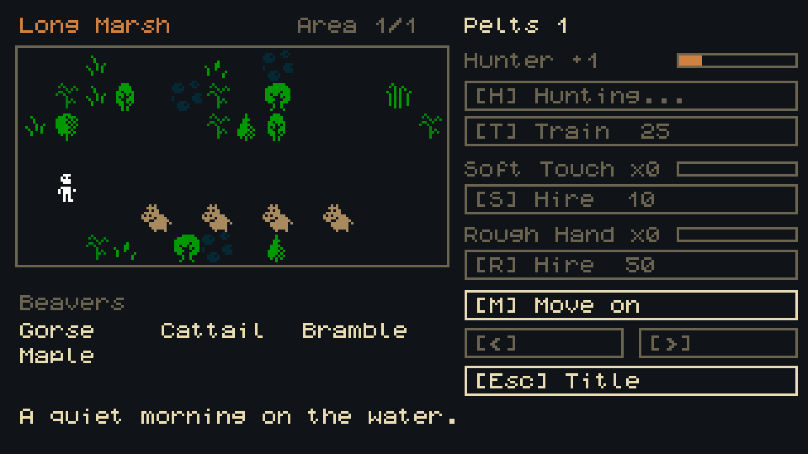
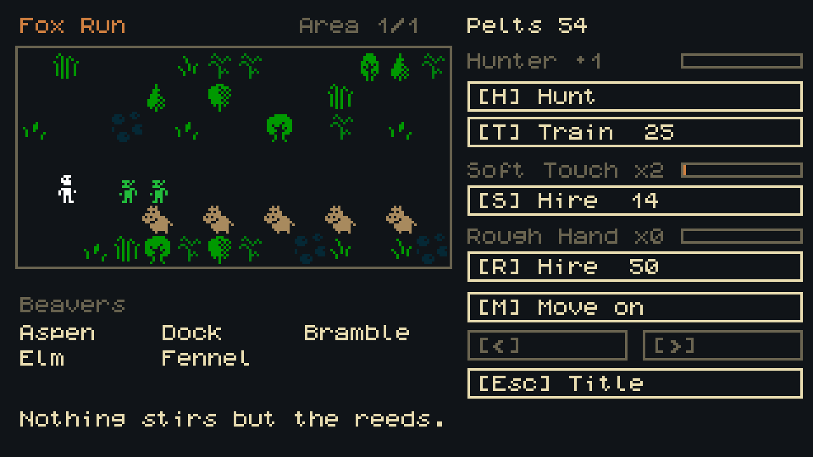

# Beaver Hunters of SPLORR!!: trip text and tuning update (November 23, 2026)

Draft, not posted. If it is ever posted on itch.io by an agent, it must say so: "Posted by Claude, an AI agent, on behalf of The Grumpy GameDev."

<!-- TO FILL once settled with the user: what the new trip text is like (no quoting the jokes is fine), and what the
tuning pass changed. Do not invent either. The play screenshots below show the PLACEHOLDER lines until
`node tools/make_screenshots.mjs` is rerun after tools/apply_trip_text.py; rerun it before posting. -->

The first build went up on October 16, 2026 with placeholder trip text and first-pass numbers. This update replaces both.

**Trip text.** TODO (the user's lines).

**Tuning.** TODO (what changed, if anything).

**Also new.** The page footer now carries the credits (Urizen tiles by vurmux, DINOBYTE font by mby), a line saying the code was made by an AI agent, and a "Send feedback" link.

The latest build is always at https://playdeezgames.github.io/beaver-hunters-of-splorr/
